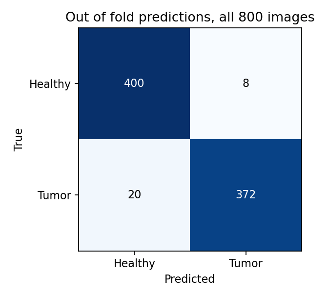

# Binary Classification of Brain Tumors Using CNN

A deep Convolutional Neural Network (CNN) built with TensorFlow/Keras for binary classification of brain MRI images into **Tumor** and **Healthy** categories. Achieves **93.75% accuracy** on the test set.

## Dataset

- **Source:** [Brain Cancer Detection MRI Images](https://www.kaggle.com/datasets/ismailpromus/brain-cancer-detection-mri-images) on Kaggle
- **Size:** 800 grayscale MRI images (resized to 100x100)
- **Classes:** Tumor (1) and Healthy (0)
- **Split:** 80% train, 20% test

## Model Architecture

- **5 Convolutional layers** with increasing filters (64, 128, 256, 364, 684) and ReLU activation
- **MaxPooling** after each convolutional layer
- **Dropout (0.2)** after the 2nd, 3rd, 4th, and 5th convolutional layers
- **2 Dense layers** (128 and 64 units) with ReLU activation
- **Output layer** with sigmoid activation for binary classification

## Training Configuration

- **Optimizer:** RMSprop
- **Loss:** Binary cross-entropy
- **Epochs:** 50
- **Batch size:** 4
- **Validation split:** 10% of training data

## Results

An earlier single 80/20 split reported 93.75%, but with 800 images one split depends heavily on the shuffle, and that notebook's outputs weren't saved. [`evaluate.py`](evaluate.py) replaces it with stratified 5 fold cross validation, using a PyTorch CNN and a baseline:

| Model | Accuracy | Sensitivity | Specificity | AUC |
| :--- | ---: | ---: | ---: | ---: |
| **4 block CNN** | **96.5% ± 0.8** | 94.9% ± 2.1 | 98.0% ± 2.0 | 0.993 |
| Logistic regression on pixels | 90.4% ± 2.8 | 88.8% ± 4.2 | 91.9% ± 3.9 | 0.931 |



Across all 800 images, 20 tumors were missed and 8 healthy scans were flagged. For a screening task the missed tumors are the costlier error, so sensitivity is the number to improve.

**Limitations.** The dataset has no patient IDs, so scans from one patient could appear in both train and test, which would inflate these scores. This is a learning project and not a medical tool.

To reproduce: `pip install torch scikit-learn pillow matplotlib`, then `python evaluate.py`.

## How to Run

1. Clone the repository:
   ```bash
   git clone https://github.com/Mukund604/Binary-Classification-Of-Brain-Tumors-using-CNN.git
   cd Binary-Classification-Of-Brain-Tumors-using-CNN
   ```

2. Install dependencies:
   ```bash
   pip install -r requirements.txt
   ```

3. The dataset is included as `archive.zip`, or you can download it from [Kaggle](https://www.kaggle.com/datasets/ismailpromus/brain-cancer-detection-mri-images) and update the dataset path in the notebook.

4. Open and run the notebook:
   ```bash
   jupyter notebook binary-classification-of-brain-tumors-using-cnn.ipynb
   ```

## Dependencies

- TensorFlow
- OpenCV
- NumPy
- Pandas
- Matplotlib

## Project Structure

```
.
├── binary-classification-of-brain-tumors-using-cnn.ipynb   # Main notebook
├── archive.zip                                              # Dataset archive
├── requirements.txt                                         # Python dependencies
└── README.md
```
